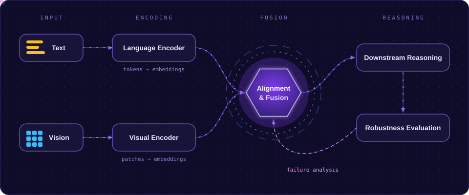
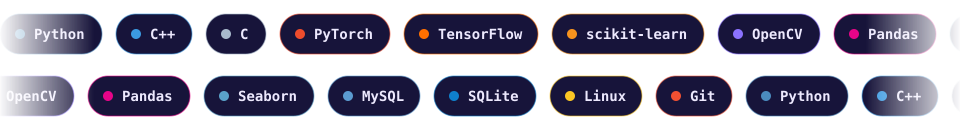

 

  

## 🧠 Research Statement

I am an undergraduate researcher in artificial intelligence working on **multimodal learning**, the study of how language, vision, and structured reasoning can be jointly modeled. My work spans natural language processing and computer vision, with a sustained interest in how representations from different modalities are aligned, fused, and used for downstream tasks.

I am particularly motivated by settings in which standard benchmark performance is an insufficient indicator of model quality, namely edge cases, cross-domain generalization, and robustness under distribution shift.

  

## 🔬 Research Interests

<table>
  <tr>
    <td width="50%" valign="top">
      <h3>🔗 Multimodal Representation Learning</h3>
      Alignment and fusion of heterogeneous modalities into shared representations.
    </td>
    <td width="50%" valign="top">
      <h3>👁️ Vision-Language Models</h3>
      Cross-modal grounding and reasoning over images and text.
    </td>
  </tr>
  <tr>
    <td width="50%" valign="top">
      <h3>⚡ Parameter-Efficient Adaptation</h3>
      Fine-tuning and transfer under limited compute.
    </td>
    <td width="50%" valign="top">
      <h3>🧪 Evaluation and Interpretability</h3>
      Robustness, failure analysis, and assessment of large-scale models.
    </td>
  </tr>
</table>

## 🛠️ Technical Skills

  

## 📊 Open-Source Activity

## 📬 Get in Touch

Open to research collaborations and discussions on multimodal learning.

